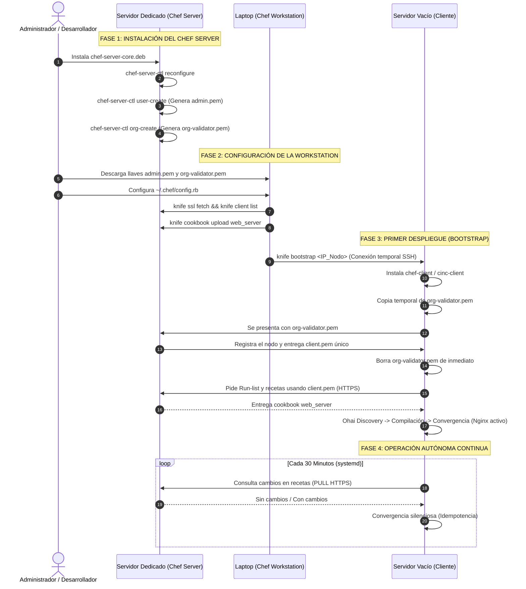

# Guía Definitiva y Manual Integral: Arquitectura, Flujo y Operación de Chef Infra

> **Documento Técnico de Referencia**  
> **Ecosistema:** Chef Infra / Cinc Client • Chef Server • Chef Workstation • Vagrant  
> **Propósito:** Comprender a fondo qué es Chef, cómo se diferencia de herramientas como Ansible, el rol crítico de Ohai, y el ciclo de vida completo de aprovisionamiento desde el "Día Cero" (configuración del servidor central) hasta la producción continua.

---

## 📑 Tabla de Contenidos

1. [¿Qué es Chef y qué problemas resuelve?](#1-qué-es-chef-y-qué-problemas-resuelve)
   - [La Deriva de Configuración (*Configuration Drift*)](#la-deriva-de-configuración)
   - [El Principio de Idempotencia](#el-principio-de-idempotencia)
   - [Transición de Mascotas a Ganado (*Pets vs. Cattle*)](#de-mascotas-a-ganado)
2. [Chef vs. Ansible: Comparativa Técnica y Arquitectónica](#2-chef-vs-ansible-comparativa-técnica-y-arquitectónica)
   - [Tabla Comparativa de Criterios](#tabla-comparativa)
   - [Filosofía: Ruby DSL vs. YAML](#ruby-dsl-vs-yaml)
   - [Modelo Push vs. Modelo Pull](#modelo-push-vs-modelo-pull)
3. [El Motor Ohai: Telemetría, Descubrimiento y Uso](#3-el-motor-ohai-telemetría-descubrimiento-y-uso)
   - [¿Para qué sirve y es para validación?](#para-qué-sirve-ohai)
   - [¿Qué datos inspecciona del sistema?](#qué-datos-inspecciona-ohai)
   - [¿Cómo usa Chef los atributos de Ohai en la práctica?](#cómo-usa-chef-los-datos-de-ohai)
4. [La Metáfora de la Cocina: Glosario Fundamental](#4-la-metáfora-de-la-cocina-glosario-fundamental)
5. [Roles y Entornos de Interacción: ¿Quién hace qué y desde dónde?](#5-roles-y-entornos-de-interacción)
   - [Chef Workstation (La laptop del desarrollador)](#chef-workstation)
   - [Chef Server (El repositorio central)](#chef-server)
   - [Chef Infra Node (El servidor cliente en producción)](#chef-infra-node)
6. [El Flujo Completo de Extremo a Extremo (De Día Cero a Producción)](#6-el-flujo-completo-de-extremo-a-extremo)
   - [Fase 1: Instalación y Configuración del Chef Server Central](#fase-1-instalación-del-chef-server)
   - [Fase 2: Configuración y Enlace de la Workstation del Desarrollador](#fase-2-configuración-de-la-workstation)
   - [Fase 3: El Nacimiento del Servidor Cliente (*Bootstrapping*)](#fase-3-el-bootstrap-inicial-del-cliente)
   - [Fase 4: Operación Autónoma en Producción (Ciclo Pull Ponderado)](#fase-4-operación-autónoma-en-producción)
7. [Detección de Variables y Aislamiento del Servidor Central](#7-detección-de-variables-y-aislamiento)
8. [Modalidad Local de Pruebas: Chef-Zero y Cinc Client](#8-modalidad-local-de-pruebas-chef-zero-y-cinc-client)

---

## 1. ¿Qué es Chef y qué problemas resuelve?

**Chef** (formalmente conocido como **Chef Infra**) es una plataforma de **Gestión de Configuración como Código (*Configuration Management as Code*)** e Infraestructura como Código (IaC). Creada en 2008, nació para sustituir la administración manual de servidores (*sysadmin* artesanal con conexiones directas por SSH) por código formal, modular, testeable y versionable en repositorios Git.

En lugar de documentar comandos en un archivo de texto o ejecutar scripts de Bash frágiles, el estado de un sistema operativo, sus paquetes, archivos de configuración, usuarios y servicios se definen en código ejecutable.

```
                  ┌─────────────────────────────────────┐
                  │    ESTADO DESEADO DECLARADO         │
                  │   (Código Ruby en Cookbooks/Git)    │
                  └──────────────────┬──────────────────┘
                                     │
                                     v
┌─────────────────────────┐   CONVERGENCIA    ┌─────────────────────────┐
│     ESTADO ACTUAL       │ ───────────────>  │     ESTADO DESEADO      │
│  (Configuración Real)   │                   │  (Garantía Idempotente) │
└─────────────────────────┘                   └─────────────────────────┘
```

### La Deriva de Configuración (*Configuration Drift*)
En una infraestructura con decenas o cientos de servidores que deberían ser idénticos (por ejemplo, nodos detrás de un balanceador de carga), los administradores a menudo aplican correcciones manuales de emergencia en caliente sobre un solo nodo. Con el paso de las semanas, los servidores divergen silenciosamente en versiones de librerías, banderas de configuración o permisos. 

Este fenómeno es el causante de fallos catastróficos en producción: *"el código funciona en el servidor 1, pero se cae en el 2"*. Chef resuelve esto ejecutando verificaciones periódicas que detectan desviaciones y devuelven el sistema de forma forzosa y automática a su **estado deseado**.

### El Principio de Idempotencia
Un script imperativo tradicional en Bash (`install.sh`) como:
```bash
echo "worker_processes 4;" >> /etc/nginx/nginx.conf
systemctl restart nginx
```
Si se ejecuta 3 veces seguidas, agregará la misma línea 3 veces (corrompiendo el archivo) y reiniciará el servicio interrumpiendo conexiones activas.

En cambio, **Chef es estrictamente idempotente**: una receta puede ejecutarse 1, 10 o 10,000 veces consecutivas sobre un servidor, y el resultado final siempre será idéntico:
* Si el paquete ya está instalado, **no lo vuelve a descargar**.
* Si el archivo ya tiene el contenido esperado, **no lo sobreescribe**.
* Si el archivo no cambió, **no emite notificaciones de reinicio al servicio**.

### De Mascotas a Ganado (*Pets vs. Cattle*)
Tradicionalmente, los servidores eran tratados como "mascotas" (*pets*): tenían nombres propios, se les cuidaba a mano y su fallo representaba una tragedia porque nadie recordaba cómo se habían configurado exactamente. 

Chef permite tratarlos como "ganado" (*cattle*): entidades anónimas, reemplazables y desechables. Si una máquina virtual falla en la nube, se destruye sin remordimientos; un nuevo nodo se enciende y Chef lo aprovisiona en minutos devolviéndolo exactamente al estado del anterior sin intervención humana.

---

## 2. Chef vs. Ansible: Comparativa Técnica y Arquitectónica

Ambas son herramientas líderes en el sector de automatización, pero parten de supuestos arquitectónicos diametralmente opuestos:

### Tabla Comparativa

| Criterio | Chef Infra (o Cinc Client) | Ansible |
| :--- | :--- | :--- |
| **Modelo de Red** | **PULL (Extracción)**: El cliente solicita sus políticas al servidor. | **PUSH (Empuje)**: El servidor central envía órdenes a los nodos. |
| **Presencia de Agente** | **Requiere Agente**: Instala `chef-client` / `cinc-client` en cada nodo. | **Agentless (Sin Agente)**: No requiere software en los nodos; usa SSH/WinRM. |
| **Lenguaje de Configuración**| **Ruby DSL**: Lenguaje estructurado completo (procedural + declarativo).| **YAML**: Formato de serialización estático y declarativo. |
| **Curva de Aprendizaje** | Media a Alta (requiere conceptos de Ruby y ciclo de ejecución). | Baja (muy intuitivo para principiantes). |
| **Escalabilidad** | Masiva (decenas de miles de nodos sin saturar el servidor central). | Limitada por la capacidad de mantener miles de sesiones SSH abiertas. |
| **Detección de Deriva** | Continua y autónoma (el demonio se despierta cada 30 min). | Bajo demanda (solo cuando un operador corre el *playbook*). |
| **Tolerancia a Fallos de Red** | Alta (si el servidor central cae, los nodos siguen convergiendo). | Nula (si el nodo central pierde conexión, nada se actualiza). |

### Ruby DSL vs. YAML
* **Ansible (YAML):** Su simplicidad es ideal para tareas directas. Sin embargo, cuando se requieren bucles complejos, transformaciones avanzadas de cadenas o consultas dinámicas, las plantillas Jinja2 y las directivas de YAML pueden volverse difíciles de mantener.
* **Chef (Ruby DSL):** Permite escribir recursos declarativos (`package`, `service`, `template`) combinados con cualquier función de Ruby (`.map`, expresiones regulares, llamadas a APIs externas o condicionales complejos) antes de que la infraestructura se compile.

### Modelo Push vs. Modelo Pull
* **En Ansible (Push):** El operador corre `ansible-playbook` desde su máquina. Si de 100 servidores había 5 apagados o con problemas de red temporal, esos 5 se quedan desactualizados.
* **En Chef (Pull):** Los nodos son autónomos. Tan pronto como un servidor nuevo o apagado arranca, contacta al Chef Server, descarga su receta y se auto-configura sin que nadie tenga que recordarlo.

---

## 3. El Motor Ohai: Telemetría, Descubrimiento y Uso

### ¿Para qué sirve Ohai?
**Ohai** es el motor de telemetría y descubrimiento del sistema que se ejecuta al inicio de cada ciclo de Chef (**Fase 1: Ohai Discovery**). Su misión es auditar el nodo y generar un árbol de datos estructurados sobre el hardware, la red y el sistema operativo.

### ¿Es para validación?
**No directamente.** 
* Ohai **no es un motor de pruebas o auditoría** (la herramienta para auditar cumplimiento normativo en el ecosistema de Chef es **InSpec**).
* Ohai es un **recolector de hechos (*Fact Collector*)**: se limita a describir la realidad del servidor tal cual está en ese segundo.
* **Uso para validación lógica:** El desarrollador sí puede usar los datos recolectados por Ohai para poner compuertas de seguridad en las recetas:
  ```ruby
  # Detener la receta si la máquina tiene menos de 2 GB de RAM
  raise "RAM insuficiente para Base de Datos" if node['memory']['total'].to_i < 2_097_152
  ```

### ¿Qué datos inspecciona Ohai?
Ohai lee atributos mediante `/proc`, `/sys`, llamadas al kernel y metadatos de proveedores de nube:

1. **Plataforma y Kernel:** `node['platform']` ('debian', 'ubuntu', 'centos'), `node['platform_version']`, `node['kernel']['release']`.
2. **Direccionamiento y Red:** `node['ipaddress']`, `node['macaddress']`, `node['hostname']`, `node['fqdn']`.
3. **Capacidad de Hardware:** `node['memory']['total']`, `node['memory']['free']`, `node['cpu']['total']`, `node['filesystem']`.
4. **Entornos Cloud:** `node['ec2']` (AWS), `node['gce']` (Google Cloud), `node['azure']` (detecta IDs de instancia, zonas y tipos de máquina).
5. **Virtualización:** `node['virtualization']['system']` ('kvm', 'docker', 'virtualbox').

### ¿Cómo usa Chef los datos de Ohai?
* **Diseño Multiplataforma:** Para instalar paquetes usando nombres y gestores diferentes según la distribución (`apt` en Debian vs `dnf` en RHEL).
* **Plantillas Dinámicas (`.erb`):** Como en [`cookbooks/web_server/templates/default/index.html.erb`](file:///C:/Users/OGSha/OneDrive/Documentos/UV/7%20Semestre/Despliegue%20de%20Software/chef-project/cookbooks/web_server/templates/default/index.html.erb), donde se inyecta en el HTML el hostname, IP y memoria calculada del servidor.
* **Búsquedas Dinámicas en Chef Server (*Chef Search*):** Un balanceador puede buscar en el servidor central: `"dame todas las IPs de los nodos con el rol web_server"` y reescribir su configuración de forma automática.

---

## 4. La Metáfora de la Cocina: Glosario Fundamental

Chef adopta una nomenclatura culinaria:

* **Resource (Recurso / Ingrediente):** El bloque indivisible. Describe un elemento del sistema y el estado que debe tener (`package`, `file`, `directory`, `service`, `template`, `user`).
* **Recipe (Receta):** Archivo con extensión `.rb` que contiene una secuencia estructurada de recursos para configurar un componente.
* **Cookbook (Libro de Recetas):** La unidad de empaquetado y distribución. Contiene recetas, atributos por defecto, plantillas ERB, archivos estáticos y pruebas.
* **Template (Plantilla):** Archivo dinámico (`.erb`) procesado con Embedded Ruby antes de escribirse en disco.
* **Attributes (Atributos):** Variables de configuración asociadas a un nodo (ej. `node['nginx']['port'] = 80`).
* **Run-list:** Lista ordenada de recetas o roles que el administrador asigna a un servidor concreto.

---

## 5. Roles y Entornos de Interacción

```
┌───────────────────────────┐      knife upload       ┌───────────────────────────┐
│     CHEF WORKSTATION      │ ──────────────────────> │        CHEF SERVER        │
│ (Laptop del Desarrollador)│                         │ (Repositorio de Políticas)│
└───────────────────────────┘                         └───────────────────────────┘
              │                                                     ▲
              │ knife bootstrap (SSH inicial)                       │
              v                                                     │ HTTPS (Pull periódico)
┌───────────────────────────────────────────────────────────────────┴─────┐
│                            CHEF INFRA NODE                              │
│                (Servidor Cliente en Producción - chef-client)           │
└─────────────────────────────────────────────────────────────────────────┘
```

1. **Chef Workstation:** Tu equipo personal. Aquí instalas la suite de desarrollo, escribes recetas en Ruby, pruebas sintaxis con `cookstyle`, pruebas entornos temporales con `kitchen` y administras el sistema con `knife`.
2. **Chef Server:** El nodo central. Funciona como almacén seguro de recetas, base de datos de nodos y motor de autenticación criptográfica.
3. **Chef Infra Node:** Cualquier máquina física, virtual o instancia en la nube donde corre el agente `chef-client` en segundo plano.

---

## 6. El Flujo Completo de Extremo a Extremo

A continuación se detalla el ciclo integral desde que no existe nada hasta que la infraestructura está funcionando de manera autónoma.



---

### Fase 1: Instalación y Configuración del Chef Server Central

Se realiza una única vez sobre un servidor dedicado (ej. Ubuntu 22.04 LTS con 4 GB de RAM):

1. **Instalación de paquetes base:**
   ```bash
   wget https://packages.chef.io/files/stable/chef-server-core/15.x.x/ubuntu/22.04/chef-server-core_15.x.x_amd64.deb
   sudo dpkg -i chef-server-core_*.deb
   ```

2. **Reconfiguración del sistema:**
   Despliega internamente PostgreSQL, Erlang, OpenResty y RabbitMQ:
   ```bash
   sudo chef-server-ctl reconfigure
   ```

3. **Creación del Usuario y la Organización:**
   ```bash
   # Crear Administrador
   sudo chef-server-ctl user-create admin_dev Carlos Sanchez csanchez@empresa.com 'PasswordSeguro123!' \
     --filename /root/admin_dev.pem

   # Crear Organización
   sudo chef-server-ctl org-create mi_empresa "Mi Empresa SA de CV" \
     --association_user admin_dev \
     --filename /root/mi_empresa-validator.pem
   ```
   *Salida crítica:* Se generan `admin_dev.pem` (llave de tu usuario) y `mi_empresa-validator.pem` (llave maestra para registrar clientes).

---

### Fase 2: Configuración de la Workstation del Desarrollador

En tu laptop personal:

1. **Copiar las llaves desde el servidor central:**
   ```bash
   mkdir -p ~/.chef
   scp root@chef-server.empresa.local:/root/admin_dev.pem ~/.chef/
   scp root@chef-server.empresa.local:/root/mi_empresa-validator.pem ~/.chef/
   ```

2. **Crear el archivo de configuración `~/.chef/config.rb`:**
   ```ruby
   current_dir = File.dirname(__FILE__)
   log_level                :info
   log_location             STDOUT
   node_name                'admin_dev'
   client_key               "#{current_dir}/admin_dev.pem"
   validation_client_name   'mi_empresa-validator'
   validation_key           "#{current_dir}/mi_empresa-validator.pem"
   chef_server_url          'https://chef-server.empresa.local/organizations/mi_empresa'
   cookbook_path            ["#{current_dir}/../cookbooks"]
   ```

3. **Verificar conexión y subir recetas:**
   ```bash
   knife ssl fetch             # Confía en el certificado SSL del Chef Server
   knife client list           # Comprueba autenticación correcta
   knife cookbook upload web_server  # Sube el cookbook al repositorio central
   ```

---

### Fase 3: El Bootstrap Inicial del Cliente

Tienes un servidor vacío (IP: `192.168.1.50`). Ejecutas desde tu laptop:
```bash
knife bootstrap 192.168.1.50 \
  --connection-user debian \
  --sudo \
  --node-name "nodo-prod-01" \
  --run-list 'recipe[web_server]' \
  -y
```

**Mecanismo de seguridad en el intercambio de llaves:**
1. Knife abre una conexión SSH inicial.
2. Descarga e instala `cinc-client` / `chef-client`.
3. Inyecta temporalmente el archivo `mi_empresa-validator.pem`.
4. El nodo contacta al Chef Server usando ese validador; el servidor le genera y entrega su **propia llave privada única** (`/etc/chef/client.pem`).
5. El nodo **elimina de inmediato** el validador temporal de su disco por seguridad.
6. A partir de aquí, el nodo ya tiene identidad criptográfica propia en el Chef Server.
7. Se ejecuta la receta, se compila y se inicia el servicio. La conexión SSH se cierra para siempre.

---

### Fase 4: Operación Autónoma en Producción

El nodo queda configurado con un servicio systemd (`chef-client.service`). 
* Cada **30 minutos**, el cliente despierta por su cuenta.
* Se autentica por HTTPS (puerto 443) contra el Chef Server usando su `/etc/chef/client.pem`.
* Si un administrador alteró un archivo o detuvo un servicio a mano, Chef detecta la diferencia y lo restablece silenciosamente (Idempotencia).

---

## 7. Detección de Variables y Aislamiento

* **¿Chef lee las variables de entorno del servidor central?**  
  **No.** Las variables de entorno (`$PATH`, `$USER`, etc.) del sistema operativo donde corre el Chef Server no se transmiten a los nodos clientes. Permitir esto violaría el aislamiento y la seguridad entre máquinas heterogéneas.
* **Mecanismos formales para suministrar variables a los clientes:**
  1. **Attributes (Atributos de Cookbook):** Variables jerárquicas definidas en [`attributes/default.rb`](file:///C:/Users/OGSha/OneDrive/Documentos/UV/7%20Semestre/Despliegue%20de%20Software/chef-project/cookbooks/web_server/attributes/default.rb).
  2. **Environments (Entornos):** Permiten asignar valores distintos a atributos según se trate de `development`, `staging` o `production`.
  3. **Data Bags Cifradas:** Mecanismo seguro para almacenar credenciales de bases de datos, tokens o certificados SSL en el Chef Server de modo que solo los nodos autorizados puedan desencriptarlos.
  4. **Variables locales en recetas:** Se puede acceder a variables de entorno del propio nodo destino mediante `ENV['VARIABLE']` o asignarlas a comandos con el recurso `environment`:
     ```ruby
     execute 'iniciar_app' do
       command 'npm start'
       environment 'NODE_ENV' => 'production'
     end
     ```

---

## 8. Modalidad Local de Pruebas: Chef-Zero y Cinc Client

Montar un Chef Server completo en laboratorios escolares o pruebas locales requiere máquinas dedicadas y configuración compleja de certificados. Para resolver esto, el ecosistema incluye **Chef-Zero** (invocado mediante `--local-mode` o `-z`):

```bash
# Como se implementa en run_demo.sh en este proyecto:
sudo cinc-client --local-mode \
                 --config-option cookbook_path="./cookbooks" \
                 --runlist 'recipe[web_server]'
```

* **Chef-Zero** arranca un mini servidor Chef en memoria RAM dentro del propio nodo, lee las recetas directamente desde la carpeta del proyecto, ejecuta el ciclo de convergencia con Ohai y se apaga de inmediato.
* **Cinc Client (`cinc-client`):** Es la distribución 100% de código abierto, comunitaria y sin restricciones de licencia de Chef Infra (equivalente a lo que Rocky Linux es para Red Hat). Comparte exactamente el mismo código base, sintaxis, motor Ohai y recursos.
