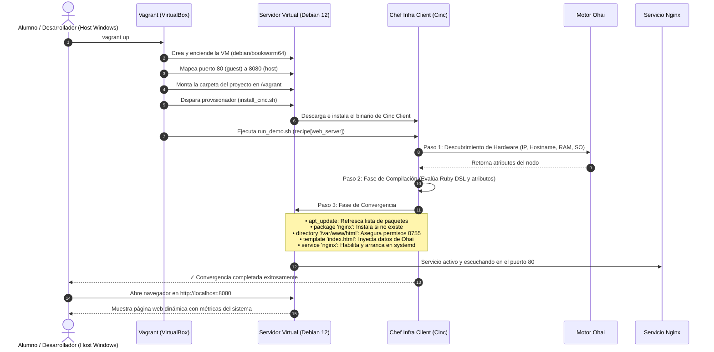

# Guía de Arquitectura, Flujo y Ciclo de Vida: Vagrant + Chef Infra

> **Materia:** Despliegue de Software • 7° Semestre • Universidad Veracruzana  
> **Stack Oficial del Proyecto:** **Vagrant** (VirtualBox + Debian 12 Bookworm) + **Chef Infra** (Cinc Client)

---

## 🧭 1. El Modelo de Dos Capas: Separación de Responsabilidades

Para entender el proyecto sin confusiones, el flujo se basa en una división de trabajo clara y profesional:

```
┌─────────────────────────────────────────────────────────────────────────────┐
│ 1. CAPA DE INFRAESTRUCTURA (Vagrant + VirtualBox)                           │
│    • Rol: Proveedor del "hardware virtual" y del Sistema Operativo.         │
│    • Qué hace: Descarga Debian 12 (Bookworm), asigna 1 GB RAM, 1 CPU y      │
│      configura el reenvío de red (puerto 80 de la VM -> puerto 8080 en PC). │
│    • Ciclo de vida: 'vagrant up' enciende y 'vagrant destroy' borra la VM.  │
├─────────────────────────────────────────────────────────────────────────────┤
│ 2. CAPA DE GESTIÓN DE CONFIGURACIÓN (Chef Infra / Cinc Client)              │
│    • Rol: El "Ingeniero de Sistemas Automatizado".                          │
│    • Qué hace: Entra a Debian, instala Nginx, renderiza la plantilla HTML   │
│      con datos del hardware recolectados por Ohai y activa el servicio.     │
│    • Principio rector: IDEMPOTENCIA (Ejecutarlo mil veces no rompe nada).   │
└─────────────────────────────────────────────────────────────────────────────┘
```

---

## 🔄 2. El Flujo de Trabajo y Ciclo de Vida Paso a Paso

El siguiente diagrama detalla la interacción exacta desde que escribes el comando en tu máquina hasta que abres el navegador:



---

## 🏛️ 3. La Dualidad de Chef: Chef Server vs. Chef Client (¿Por qué usamos Chef-Zero / Modo Local?)

Para comprender a fondo la arquitectura y lo que ocurre durante la ejecución, es indispensable distinguir los dos roles principales en el ecosistema de Chef:

### A. Chef Server (El Cerebro Central)
* **Función:** Es un servidor central dedicado que actúa como la "fuente única de la verdad" en arquitecturas empresariales.
* **Qué almacena:** Todos los cookbooks, roles, ambientes, llaves criptográficas RSA de autenticación y el catálogo de políticas de la organización.
* **Modelo PULL:** El Chef Server nunca empuja cambios activamente; espera pasivamente a que los nodos clientes se conecten por HTTPS a solicitar sus recetas asignadas.

### B. Chef Infra Client (El Agente Ejecutor)
* **Función:** Es el software agente (`chef-client` o `cinc-client`) instalado en cada uno de los servidores gestionados (nodos).
* **Qué hace:** Se ejecuta de forma programada (por ejemplo, cada 30 minutos en producción), invoca a **Ohai** para auditar el hardware y la red del nodo, se comunica con el Chef Server, descarga las recetas correspondientes y ejecuta la fase de convergencia en el sistema operativo.

### C. La Solución para Laboratorios: Chef-Zero (`--local-mode`)
* **El desafío en clase:** Desplegar un Chef Server completo para una práctica escolar requeriría otra máquina virtual dedicada con un mínimo de **4 GB de RAM**, además de una laboriosa gestión de certificados SSL y llaves de usuario con la herramienta `knife`.
* **La alternativa implementada:** En nuestro script [`run_demo.sh`](file:///C:/Users/OGSha/OneDrive/Documentos/UV/7%20Semestre/Despliegue%20de%20Software/chef-project/run_demo.sh) utilizamos la bandera **`--local-mode`** (conocida técnicamente como **Chef-Zero**). En este modo, el cliente levanta un servidor efímero en memoria RAM, lee los cookbooks directamente del disco local (`cookbooks/web_server`), ejecuta la convergencia y se apaga de inmediato. Esto otorga el 100% de la funcionalidad de Chef con cero sobrecarga de red o servidores adicionales.

### D. ¿Por qué se llama `cinc-client` y no `chef-client`? (La analogía Red Hat vs. Rocky Linux)
Es común preguntarse por qué el comando instalado es `cinc-client` en lugar de `chef-client`. La razón es legal y de licenciamiento:
* **El antecedente:** En 2019, la empresa propietaria (Progress Software) cambió la licencia de los binarios precompilados de Chef a una licencia comercial de pago (**Chef Enterprise License**).
* **La respuesta comunitaria:** La comunidad de código abierto tomó el código fuente libre de Chef, removió los logotipos y marcas registradas de Progress, y lo compila libremente bajo el nombre de **CINC** (*Cinc Is Not Chef*).
* **La analogía:** Es exactamente la misma relación que existe entre **Red Hat Enterprise Linux (RHEL)** (comercial de pago) y **Rocky Linux / AlmaLinux** (compilación comunitaria 100% idéntica y libre).
* **Compatibilidad 1:1:** `cinc-client` y `chef-client` son **idénticos e intercambiables bit a bit**. Usan las mismas recetas, la misma sintaxis en Ruby DSL, el mismo motor Ohai y los mismos recursos. Usamos Cinc porque permite a cualquier estudiante instalarlo en 15 segundos sin contratos ni tarjetas de crédito.

---

## ⚡ 4. La Idempotencia en Acción: Demostración en Vivo

Uno de los criterios más importantes de evaluación en la materia es demostrar **qué es la idempotencia**:

1. **Primera Ejecución (`vagrant up`):**  
   Chef detecta que Nginx no está instalado y que la página no existe.  
   *Resultado en terminal:* `5 resources updated` (Se instaló el paquete, se creó el directorio, se generó la plantilla y se arrancó el servicio).
2. **Segunda Ejecución (`vagrant provision`):**  
   Chef vuelve a inspeccionar el sistema. Nota que el paquete ya está presente, el archivo ya es idéntico y el servicio ya está corriendo.  
   *Resultado en terminal:* `0 resources updated` (Convergencia en 2 segundos sin tocar ni reiniciar nada innecesariamente).

---

## 🛠️ 5. Comandos Esenciales para el Día a Día

Todos los comandos se ejecutan desde la raíz del proyecto en PowerShell o Terminal:

| Comando | Acción |
| :--- | :--- |
| `vagrant up` | Enciende la máquina virtual y ejecuta Chef por primera vez. |
| `vagrant provision` | Vuelve a ejecutar Chef sobre la máquina ya encendida (ideal para probar cambios en la receta y demostrar idempotencia). |
| `vagrant ssh` | Abre una terminal interactiva dentro de la máquina Debian 12. |
| `vagrant halt` | Apaga la máquina virtual guardando su estado. |
| `vagrant destroy -f` | Elimina por completo la máquina virtual, liberando disco y dejando tu PC 100% limpia. |

---

## 📂 6. Directorio y Responsabilidades de Cada Archivo

```
chef-project/
│
├── 📜 DOCUMENTACIÓN Y TEORÍA:
│   ├── README.md                  -> Portada principal, stack e inicio rápido.
│   ├── LAB_GUIDE.md               -> Guía práctica de laboratorio para compañeros.
│   ├── MONOGRAFIA_CHEF.md         -> Monografía exhaustiva en prosa continua sobre Chef.
│   ├── GUIA_ACTIVIDAD.md          -> Guía íntegra de los 10 puntos de exposición y actividad.
│   └── ARQUITECTURA_Y_FLUJO.md    -> Este documento de flujo de trabajo y arquitectura.
│
├── 📦 VIRTUALIZACIÓN (VAGRANT):
│   └── Vagrantfile                -> Configuración de la VM Debian 12 y reenvío de puertos.
│
├── 🍳 EL CORAZÓN DE CHEF (COOKBOOK):
│   └── cookbooks/web_server/
│       ├── metadata.rb            -> Nombre, versión y compatibilidad (Debian).
│       ├── attributes/default.rb   -> Variables parametrizables (puerto 80, mensajes).
│       ├── files/default/         -> Imágenes y tipografías locales (Ranade WOFF2).
│       ├── recipes/default.rb      -> Receta en Ruby DSL con recursos nativos de systemd.
│       └── templates/default/
│           ├── index.html.erb      -> Dashboard HTML5 moderno inyectado con datos de Ohai.
│           └── easter_egg.html.erb -> Plantilla secreta del Reto Final (Easter Egg).
│
└── 🚀 SCRIPTS AUXILIARES:
    ├── install_cinc.sh            -> Descarga e instala Cinc Client en Debian en 15 segundos.
    └── run_demo.sh                -> Ejecuta Chef en Modo Local y valida la respuesta HTTP.
```

---

## 🐳 7. ¿Y cómo encaja Docker en la teoría de la exposición?

Aunque para el laboratorio no ejecutamos Docker dentro de la VM (para evitar lentitud y sobreingeniería en el salón), **en la exposición oral (Punto 7 de la guía)** explicarás su relación en la industria real:
* **Chef administra la plataforma:** En servidores de producción, Chef se encarga de instalar el motor de Docker (`docker-ce`), configurar sus demonios, asignar almacenamiento persistente y parchar el kernel del host.
* **Docker transporta las aplicaciones:** Los desarrolladores empaquetan sus microservicios dentro de contenedores inmutables que corren sobre los hosts gestionados por Chef.
* **Test Kitchen con Docker:** En los pipelines de CI/CD, Chef utiliza contenedores Docker efímeros para probar recetas en segundos antes de enviarlas a máquinas virtuales o servidores finales.
