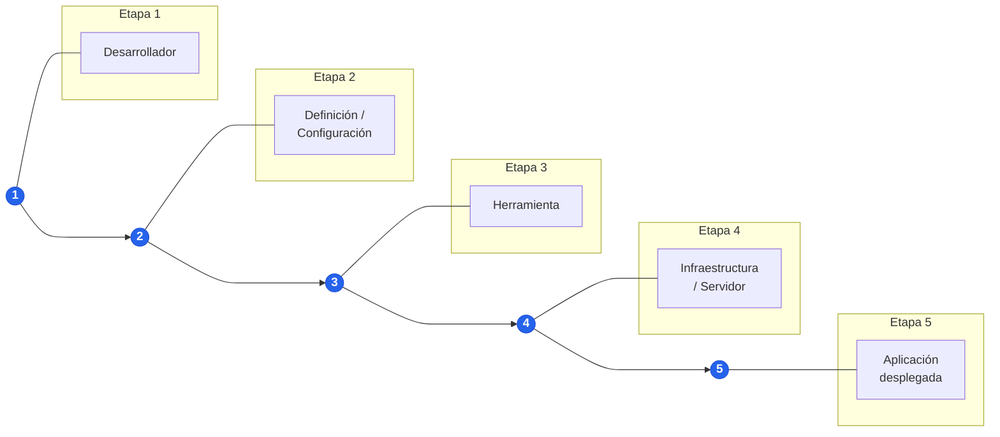

# Guía Oficial de la Actividad: Herramientas para Automatización y Despliegue

> **Documento Base:** Reproducción íntegra y estructurada de la guía de evaluación de la actividad académica.  
> **Experiencia Educativa:** Despliegue de Software • 7° Semestre • Universidad Veracruzana  
> **Herramienta Asignada al Equipo:** **Chef** (Gestión de Configuración e Infraestructura como Código)

---

## 🎯 Propósito de la Actividad

Analizar una herramienta utilizada en procesos de despliegue, automatización de infraestructura, gestión de configuración o integración continua, identificando su **propósito**, **funcionamiento**, **casos de uso** y **papel dentro de un proceso de CI/CD**. Como parte de la actividad, cada equipo deberá realizar una **demostración práctica** de la herramienta y diseñar un **laboratorio breve** que permita al resto del grupo experimentar con ella.

Las herramientas asignadas en el curso son: **Terraform, Ansible, Puppet, Chef, Salt y Jenkins**.

> [!IMPORTANT]
> **Enfoque de discernimiento crítico:** Aunque algunas herramientas pueden resolver problemas similares, es fundamental identificar **qué problema resuelve principalmente cada herramienta** y **en qué etapa de un proceso de despliegue tendría sentido utilizarla**.

---

## 📑 Parte 1. Investigación y Exposición (20–25 minutos)

Cada equipo deberá preparar una exposición de aproximadamente **20 a 25 minutos**, abordando como mínimo los siguientes **10 apartados obligatorios**:

### 1. Introducción a la herramienta
* ¿Qué es?
* ¿Para qué sirve?
* ¿Qué problema busca resolver?
* ¿En qué escenarios se utiliza?

### 2. Clasificación y papel en el despliegue
* Identificar si se utiliza principalmente para:
  * *Infrastructure as Code* (IaC)
  * Aprovisionamiento (*Provisioning*)
  * Gestión de configuración (*Configuration Management*)
  * Automatización general
  * Integración continua (CI)
  * Entrega / Despliegue continuo (CD)
  * Otra función específica dentro del ciclo de vida.

### 3. Arquitectura y funcionamiento
* Explicar sus principales componentes y la forma en que trabaja internamente.
* Ejemplos de aspectos a abordar según la herramienta:
  * ¿Utiliza una arquitectura *agent* (con agente) o *agentless* (sin agente)?
  * ¿Opera bajo un modelo servidor-agente (*Pull* vs *Push*)?
  * ¿Se basa en archivos declarativos, imperativos, pipelines o estados deseados (*desired state*)?

### 4. Conceptos y elementos principales
* Presentar la terminología necesaria para comenzar a utilizarla:
  * Archivos de configuración, módulos, recursos (*resources*), *playbooks*, *manifests*, *recipes* (recetas), *cookbooks*, *states*, *pipelines*, *plugins*, atributos, según corresponda a la herramienta.

### 5. Ejemplo básico de configuración
* Mostrar y explicar un archivo o fragmento real utilizado por la herramienta.
* **Requisito indispensable:** No solamente mostrar el código en pantalla; el equipo deberá **explicar qué hace cada sección importante** de manera clara y didáctica.

### 6. Flujo de trabajo gráfico
* Explicar gráficamente el flujo de operación de extremo a extremo, siguiendo el esquema oficial de 5 etapas:

### 7. Integración con tecnologías vistas en clase
* Explicar cómo podría utilizarse e integrarse junto con:
  * **Git** y **GitHub** (control de versiones y flujos colaborativos).
  * **Docker** y **Docker Compose** (contenedores y orquestación local).
  * **Servidores Linux** o máquinas virtuales (**Vagrant**).
  * **Servicios en la nube** (AWS, GCP, Azure, etc.).

### 8. Ventajas, limitaciones y casos de uso
* ¿Cuándo conviene utilizarla?
* ¿Cuándo podría resultar excesiva (*overkill*) o innecesaria?
* ¿Qué otras herramientas del mercado o del curso compiten directamente con ella o se complementan con ella?

### 9. Demostración práctica¹
* Ejecutar en vivo un ejemplo funcional en el que pueda observarse claramente qué automatiza la herramienta.

> ¹ **Nota oficial de evaluación:** *No es necesario que la demostración sea compleja. Se evaluará principalmente que permita comprender qué tarea manual está siendo sustituida o automatizada.*

### 10. Conclusión (Preguntas de cierre obligatorias)
Concluir la presentación respondiendo puntualmente estas tres preguntas:
1. **¿Qué automatiza esta herramienta?**
2. **¿Qué reemplaza de un proceso manual?**
3. **¿Cómo se integraría en un pipeline de despliegue real?**

---

## 🧪 Parte 2. Laboratorio para el Grupo

Además de la exposición, cada equipo deberá diseñar una **actividad práctica reproducible** para que el resto de sus compañeros utilice la herramienta en clase.

### Elementos obligatorios que debe incluir la guía del laboratorio:
1. **Objetivo:** Propósito formativo de la práctica.
2. **Escenario o problema a resolver:** Contexto práctico que motiva la automatización.
3. **Requisitos previos:** Software, paquetes o configuraciones necesarias antes de iniciar.
4. **Instrucciones paso a paso:** Secuencia ordenada y clara de acciones.
5. **Archivos necesarios:** Código fuente, configuraciones o plantillas requeridas.
6. **Comandos utilizados:** Comandos exactos de ejecución y verificación.
7. **Resultado esperado:** Qué debe ocurrir al finalizar la ejecución correctamente.
8. **Pequeña evidencia de comprobación:** Qué captura, salida en consola o prueba demuestra que la actividad fue completada con éxito.

### Lógica pedagógica recomendada:
Conviene que el laboratorio tenga una estructura didáctica de:
$$\textbf{Antes (Proceso Manual)} \longrightarrow \textbf{Automatización (Herramienta)} \longrightarrow \textbf{Resultado}$$
Es decir, que el estudiante pueda reconocer qué tendría que hacer manualmente paso por paso y cómo la herramienta permite automatizarlo de forma repetible y sin errores.

### Tabla comparativa de laboratorios sugeridos por herramienta:

| Herramienta | Posible laboratorio oficial sugerido en la guía |
| :--- | :--- |
| **Terraform** | Crear automáticamente infraestructura sencilla, por ejemplo una VM o recursos mediante un proveedor accesible para el curso. |
| **Ansible** | Configurar un servidor: instalar Nginx, copiar una aplicación, configurar el servicio e iniciarlo mediante un playbook. |
| **Puppet** | Definir el estado deseado de un servidor e instalar/configurar automáticamente un servicio. |
| **Chef** ⭐ | **Crear una receta para instalar y configurar un servicio o aplicación.** |
| **Salt** | Administrar/configurar uno o más nodos mediante estados y ejecutar tareas remotamente. |
| **Jenkins** | Construir un pipeline que obtenga código desde Git, ejecute pruebas, construya una imagen Docker y realice alguna acción de despliegue. |

---

## 🏆 Parte 3. Reto Final del Laboratorio

Para evitar que los compañeros simplemente copien y peguen los comandos de la exposición de manera mecánica, cada equipo deberá terminar su laboratorio con un **pequeño reto o modificación**.

### Ejemplos de modificaciones o retos válidos:
* Cambiar el puerto del servicio.
* Agregar un paquete adicional al servidor.
* Desplegar una segunda aplicación o vista web.
* Modificar una variable o atributo de configuración.
* Incorporar otro contenedor o servicio.
* Agregar una etapa al pipeline.
* Cambiar algún parámetro de infraestructura.

> [!WARNING]
> **Regla estricta para el equipo expositor:**  
> El equipo expositor deberá proporcionar todas las instrucciones, contexto y pistas necesarias para que sus compañeros resuelvan el reto, pero **NO deberá entregar directamente la solución resuelta del reto**.

---

## 📦 Entregables Oficiales

Cada equipo entregará los siguientes 4 elementos:
1. **Presentación utilizada** en la exposición oral.
2. **Archivos / código de la demostración** funcional.
3. **Guía de laboratorio reproducible** (con el reto final incluido).
4. **Archivo `README.md`** con los requisitos e instrucciones claras para ejecutar el ejercicio.

> **Recomendación oficial:** Concentrar todos los entregables en un **repositorio de GitHub**.
